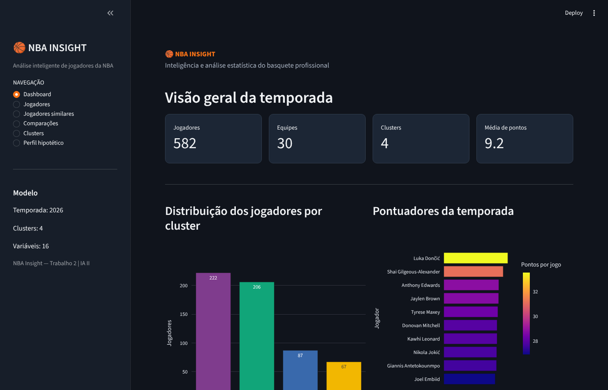
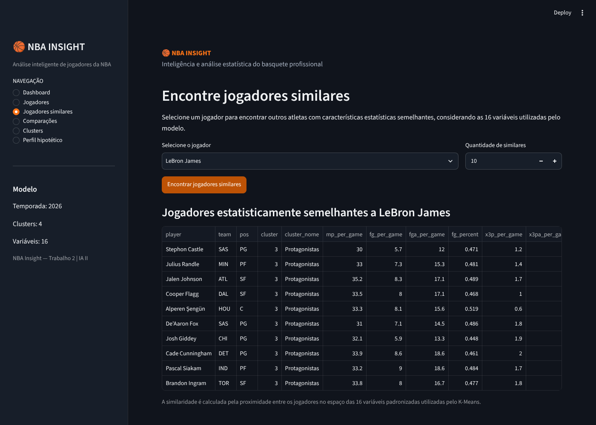
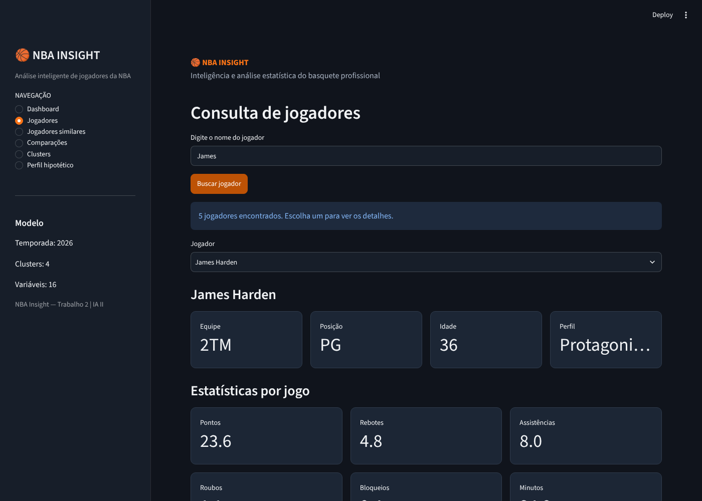
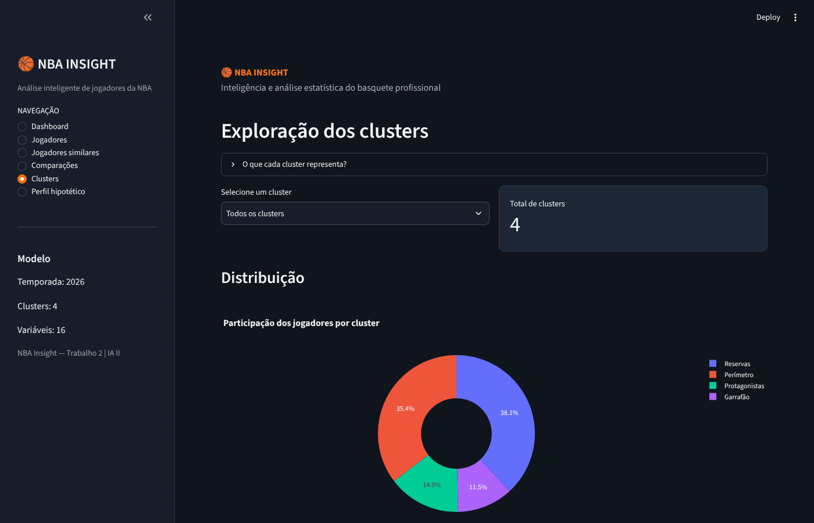
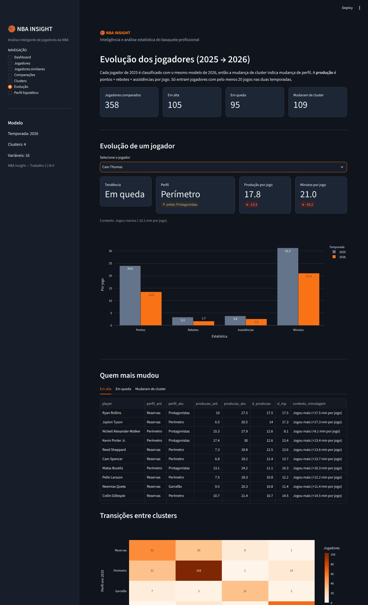
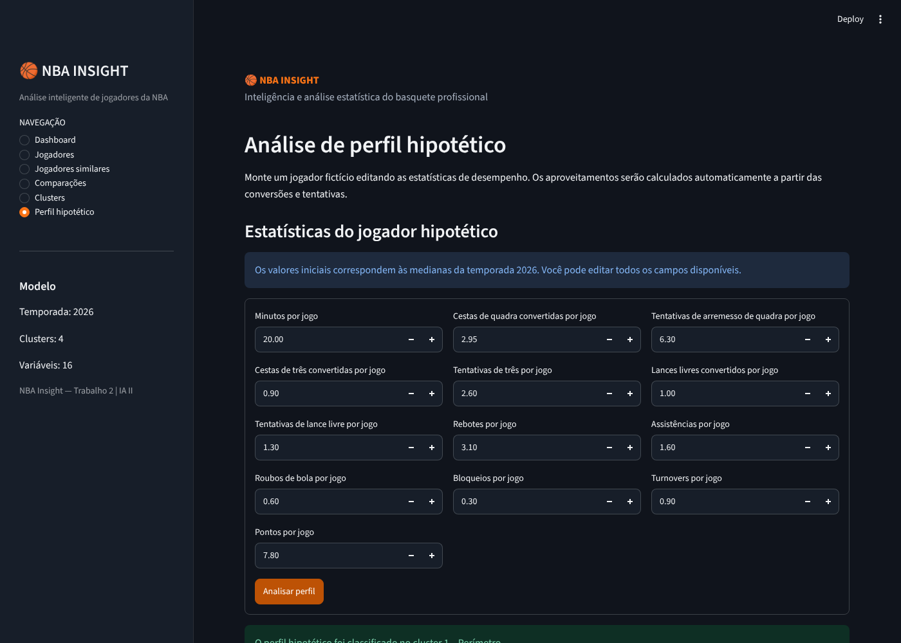
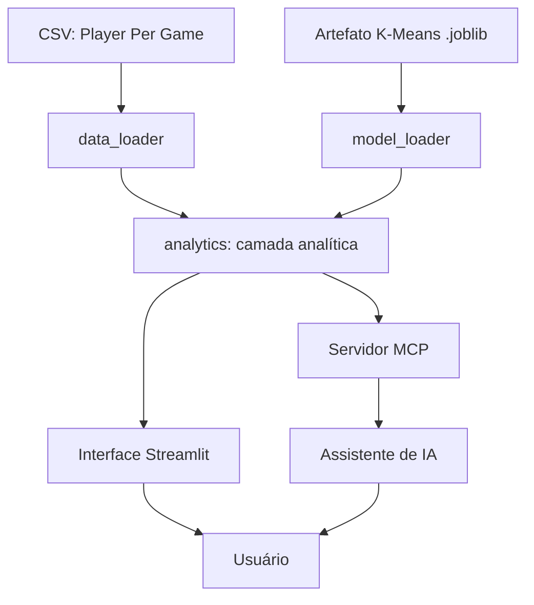

# 🏀 NBA Insight

Plataforma de apoio à análise de desempenho de jogadores da NBA, com um modelo de Machine Learning e um servidor MCP que conecta assistentes de IA aos dados e ao modelo.

Trabalho 2 de Inteligência Artificial II (2026/02). Modalidade 3: integração com IA em contexto avançado (MCP).

Autor: Otávio Ferreira Dahlke | Professor: Rhauani Weber Aita Fazul

## 1. O problema

Quem analisa basquete (analistas de clube, comissões técnicas, jornalistas, fãs) faz perguntas como "quem joga parecido com este jogador?", "quem poderia substituí-lo?" ou "que tipo de jogador é esse, além da posição que aparece na ficha?".

A posição tradicional (armador, ala, pivô) descreve cada vez pior o que o jogador faz em quadra: tem pivô que arremessa de três e armador que pega mais rebote que ala.

A dor, então, é que comparar jogadores e achar perfis parecidos é lento, manual e depende de intuição.

| Público | O que ganha |
|---|---|
| Analistas e scouting | Achar substitutos e alternativas de perfil parecido em segundos |
| Comissões técnicas | Entender o papel estatístico de cada atleta, e não só a posição |
| Jornalistas e fãs | Consultar e comparar jogadores por conversa, sem planilha |

## 2. A solução

O NBA Insight junta três partes:

1. **Modelo de ML (K-Means):** agrupa os jogadores da temporada 2026 em 4 perfis estatísticos, sem usar a posição como entrada.
2. **Interface web (Streamlit):** dashboard, consulta de jogadores, jogadores similares, comparação, exploração dos clusters, evolução entre temporadas e simulação de um jogador hipotético.
3. **Servidor MCP (FastMCP):** expõe essas mesmas funções como ferramentas para um assistente de IA, como o Claude Desktop. O usuário pergunta em linguagem natural e o assistente consulta os dados e o modelo.

### Os 4 clusters

Cada cluster recebe um nome automaticamente, a partir do perfil médio do grupo (o K-Means só devolve números de 0 a 3). A regra, em `analytics.get_cluster_names()`: o cluster com menos minutos é **Reservas**, o com mais minutos é **Protagonistas**, e entre os dois do meio o que tem mais rebotes e tocos é **Garrafão** (o outro é **Perímetro**).

| Cluster | Nome | Jogadores | Perfil médio |
|---|---|---|---|
| 0 | Reservas | 222 | ≈ 10 min e 3,6 pts por jogo |
| 1 | Perímetro | 206 | ≈ 23 min, 10 pts, mais bolas de três |
| 2 | Garrafão | 67 | ≈ 23 min, 9,7 pts, FG% ≈ 59% e quase 1 toco por jogo |
| 3 | Protagonistas | 87 | ≈ 32 min, 20,7 pts e 4,9 assistências |

### Evolução entre temporadas (2025 → 2026)

O modelo foi treinado na temporada 2026. Para ver como os jogadores mudaram, as linhas de 2025 passam pelo **mesmo** imputer, scaler e K-Means. Como a régua é a mesma nas duas temporadas, mudar de cluster indica mudança de perfil estatístico.

- **Produção** = pontos + rebotes + assistências por jogo.
- **Tendência:** "Em alta" ou "Em queda" quando a produção varia pelo menos 3,0; caso contrário, "Estável".
- **Contexto de minutagem:** informa se a mudança veio junto com variação de pelo menos 5 minutos por jogo. Muitas mudanças de cluster refletem jogar mais ou menos, e não jogar melhor ou pior.
- **Critérios:** só entram jogadores presentes nas duas temporadas e com pelo menos 20 jogos em cada (a comparação é feita pelo identificador do jogador).

Com os dados atuais, 358 jogadores atendem aos critérios: 105 em alta, 95 em queda e 158 estáveis, e 109 mudaram de cluster. Os limiares ficam em `config.py` e as temporadas são parâmetros das funções, mas o modelo foi ajustado em 2026, então épocas muito antigas são menos confiáveis.

Essa análise está disponível na página **Evolução** da interface e nas ferramentas MCP `analisar_evolucao_jogador` e `listar_jogadores_em_evolucao`. Assim o assistente consegue responder, por exemplo, "quem evoluiu mais de 2025 para 2026?" e explicar a mudança.

## Demonstração

Capturas de tela do app e saídas dos testes estão em [`docs/exemplos/`](docs/exemplos/).

| Dashboard | Jogadores similares |
|---|---|
|  |  |

| Busca com nomes iguais | Clusters |
|---|---|
|  |  |

| Evolução de um jogador (em queda) | Perfil hipotético |
|---|---|
|  |  |

Página de evolução completa, com um jogador em alta: [`06_evolucao_jogador.png`](docs/exemplos/06_evolucao_jogador.png).

Também há o log de uma sessão real de um cliente MCP chamando as ferramentas, inclusive as de evolução ([`mcp_teste_cliente.txt`](docs/exemplos/mcp_teste_cliente.txt)) e o resultado dos testes ([`pytest.txt`](docs/exemplos/pytest.txt)).

## 3. Como a IA é utilizada

| Camada | Técnica | Papel |
|---|---|---|
| Aprendizado não supervisionado | K-Means (K=4), com imputação pela mediana e padronização | Descobrir perfis de jogadores e classificar novos perfis |
| Similaridade | Distância euclidiana no espaço padronizado das 16 estatísticas | Encontrar jogadores parecidos |
| Análise temporal | O mesmo K-Means aplicado a duas temporadas; variação de produção e transição entre clusters | Identificar jogadores em alta ou em queda |
| Integração com assistente | Servidor MCP (FastMCP) com 9 ferramentas | Deixar um modelo de linguagem usar os dados e o modelo como ferramentas |

O assistente de linguagem natural entra só como interface. Quem calcula é o código e o modelo, então ele não precisa "chutar" estatísticas.

## 4. Arquitetura



A interface e o servidor MCP usam a mesma camada analítica (`analytics.py`), então as regras não ficam duplicadas. Mais detalhes em [`docs/architecture.md`](docs/architecture.md).

## 5. Dados e modelo

**Dataset.** O arquivo é o `Player Per Game.csv` do conjunto [NBA, ABA, BAA Stats](https://www.kaggle.com/datasets/sumitrodatta/nba-aba-baa-stats/data), do Kaggle (dados do Basketball Reference). Ele já está em `data/`.

**Recorte.** Liga NBA, temporada 2026, uma linha por jogador. Jogadores que passaram por mais de um time usam a linha agregada (`2TM`, `3TM` ou `4TM`). No fim sobram 582 jogadores.

**Atributos (16, todos por jogo):** minutos, cestas de quadra (convertidas, tentadas e %), bolas de três (convertidas, tentadas e %), lances livres (convertidos, tentados e %), rebotes, assistências, roubos, tocos, erros e pontos.

**Pré-processamento.** Valores ausentes (por exemplo, o % de três de quem nunca tentou) são preenchidos pela mediana. No perfil hipotético, um aproveitamento sem tentativas também é tratado como ausente, e não como 0%. Depois os dados passam pelo `StandardScaler`.

| Parâmetro do modelo | Valor |
|---|---|
| Algoritmo | K-Means |
| Clusters | 4 |
| `n_init` | 10 |
| `random_state` | 42 |
| Atributos | 16 |

O modelo treinado, junto com o imputer e o scaler, fica salvo em `artifacts/kmeans_nba_2026.joblib`. A aplicação carrega esse arquivo e não precisa treinar de novo a cada execução.

## 6. Como executar

### 6.1 Requisitos

- Python 3.10 ou superior (testado com Python 3.13)
- Git (opcional, só se for clonar)
- Windows, Linux ou macOS

### 6.2 Obter o projeto

Com Git:

```bash
git clone https://github.com/otaviof3/trabalho_2_ia_2_NBA_insight.git
cd trabalho_2_ia_2_NBA_insight
```

Ou baixe o ZIP pelo GitHub (botão **Code → Download ZIP**), extraia e abra um terminal dentro da pasta extraída (`trabalho_2_ia_2_NBA_insight-main`).

Todos os comandos abaixo devem ser executados dentro dessa pasta.

### 6.3 Ambiente virtual e dependências

Windows (PowerShell):

```powershell
python -m venv .venv
.\.venv\Scripts\Activate.ps1
python -m pip install --upgrade pip
pip install -r requirements.txt
```

Linux ou macOS:

```bash
python3 -m venv .venv
source .venv/bin/activate
python -m pip install --upgrade pip
pip install -r requirements.txt
```

Para reproduzir exatamente as versões testadas, use `pip install -r requirements-lock.txt` no lugar de `requirements.txt`.

### 6.4 Dataset

O arquivo `data/Player Per Game.csv` já vem no repositório. Se precisar baixar de novo, ele está no [Kaggle](https://www.kaggle.com/datasets/sumitrodatta/nba-aba-baa-stats/data); coloque-o na pasta `data/` com esse mesmo nome.

### 6.5 Treinar o modelo de novo (opcional)

O artefato treinado já está em `artifacts/`. Para gerá-lo de novo:

```bash
python scripts/train_model.py
```

### 6.6 Abrir a interface

```bash
streamlit run src/nba_insight/app.py
```

O terminal mostra o endereço local (normalmente http://localhost:8501). O tema escuro é fixado em `.streamlit/config.toml`.

### 6.7 Rodar o servidor MCP

```bash
python -m src.nba_insight.mcp_server
```

Para testar as ferramentas no MCP Inspector:

```bash
mcp dev src/nba_insight/mcp_server.py
```

### 6.8 Usar com o Claude Desktop

Adicione isto à configuração de servidores MCP do Claude Desktop:

```json
{
  "mcpServers": {
    "nba-insight": {
      "command": "C:\\CAMINHO\\nba-insight\\.venv\\Scripts\\python.exe",
      "args": ["-m", "src.nba_insight.mcp_server"],
      "env": { "PYTHONPATH": "C:\\CAMINHO\\nba-insight" }
    }
  }
}
```

Troque `C:\\CAMINHO\\nba-insight` pelo caminho absoluto da pasta do projeto no seu computador (no Linux ou macOS, use o caminho de `.venv/bin/python`). Depois de salvar, reinicie o Claude Desktop.

Perguntas que dá para fazer ao assistente:

- "Quais jogadores se parecem com Brandon Ingram? Liste os 5 mais próximos."
- "Compare Nikola Jokić e Luka Dončić."
- "Mostre o resumo de cada cluster."
- "Quais jogadores têm pelo menos 20 pontos e 5 assistências por jogo?"
- "Quem evoluiu mais de 2025 para 2026?"
- "O que mudou no jogo do Cam Thomas? Ele piorou ou só jogou menos?"
- "Quais jogadores mudaram de cluster de 2025 para 2026?"
- "Crie um jogador com 30 minutos, 22 pontos, 7 rebotes e 5 assistências e diga em que cluster ele cai."

### 6.9 Testes

```bash
pytest -v
```

São 68 testes: os de unidade (com dados simulados) e os de integração em `tests/test_integracao.py` e `tests/test_evolucao.py`, que usam o dataset e o modelo reais.

## 7. Ferramentas MCP

| Ferramenta | O que faz |
|---|---|
| `buscar_jogador` | Pesquisa um jogador pelo nome (ignora acentos e maiúsculas) |
| `comparar_jogadores` | Compara estatísticas de jogadores |
| `buscar_jogadores_similares` | Encontra jogadores estatisticamente próximos |
| `consultar_clusters` | Mostra os clusters e o resumo de cada um |
| `buscar_jogadores` | Filtra jogadores por critérios estatísticos (mínimo e máximo) |
| `analisar_perfil_hipotetico` | Classifica um jogador fictício e lista os reais mais parecidos |
| `consultar_modelo` | Retorna informações do modelo (temporada, clusters, atributos, nomes dos clusters) |
| `analisar_evolucao_jogador` | Compara um jogador entre duas temporadas: perfil, variações, tendência e contexto de minutagem |
| `listar_jogadores_em_evolucao` | Lista quem mais subiu, quem mais caiu ou quem mudou de cluster, com a matriz de transições |

Todas as ferramentas têm descrição, para que o assistente saiba quando usar cada uma, e as respostas incluem o nome do cluster (`cluster_nome`). Se um nome for ambíguo (por exemplo, "James"), o erro lista os candidatos para o assistente pedir o nome completo.

## 8. Limitações

- Os grupos não são bem separados: o Silhouette Score (≈ 0,24, medido no modelo) indica estrutura real, mas com fronteiras difusas. Jogadores no limite entre dois grupos podem mudar de cluster com pequenas variações nos dados.
- Estatística por jogo mistura talento com oportunidade: um jogador bom com poucos minutos cai junto com os reservas.
- O modelo é treinado só na temporada 2026; a evolução compara 2025 e 2026 com essa mesma régua, e épocas muito antigas ficam menos confiáveis. Lesões, trocas de time e contexto da equipe não entram.
- Mudança de cluster nem sempre é mudança de rendimento: muitas vezes é variação de minutagem. Por isso a análise de evolução traz o contexto de minutos.
- Calouros e quem não jogou nas duas temporadas (ou jogou menos de 20 jogos) ficam fora da análise de evolução.
- A classificação em cluster não é uma previsão de desempenho futuro.
- Perfis hipotéticos muito fora do padrão da liga geram classificações pouco representativas.

## 9. Próximos passos

- **Projeção de desempenho:** um modelo preditivo, validado em temporadas futuras, com cenários do tipo "e se jogar mais minutos?".
- **Mais temporadas na evolução:** trajetória de vários anos por jogador (por exemplo, 2022 a 2026) e gráfico de linha, reaproveitando as mesmas funções.
- **Mais estatísticas:** métricas avançadas (PER, uso, BPM) e valores por 36 minutos, para reduzir o viés da minutagem.
- **Uso real:** publicar a interface (por exemplo, no Streamlit Community Cloud) e o servidor MCP, para que pessoas usem sem instalar nada.

## 10. Estrutura do projeto

```text
.
├── artifacts/
│   └── kmeans_nba_2026.joblib
├── data/
│   └── Player Per Game.csv
├── docs/
│   ├── architecture.md
│   └── exemplos/               # prints do app e logs
├── scripts/
│   └── train_model.py
├── src/
│   └── nba_insight/
│       ├── __init__.py
│       ├── analytics.py
│       ├── app.py
│       ├── config.py
│       ├── data_loader.py
│       ├── mcp_server.py
│       └── model_loader.py
├── tests/
│   ├── test_analytics.py
│   ├── test_evolucao.py
│   ├── test_integracao.py
│   └── test_mcp_tools.py
├── .streamlit/
│   └── config.toml
├── .gitignore
├── README.md
├── requirements.txt
└── requirements-lock.txt
```

## 11. Créditos

Dados do Basketball Reference, pelo dataset de Sumitro Datta no Kaggle. Projeto acadêmico da disciplina de Inteligência Artificial II.