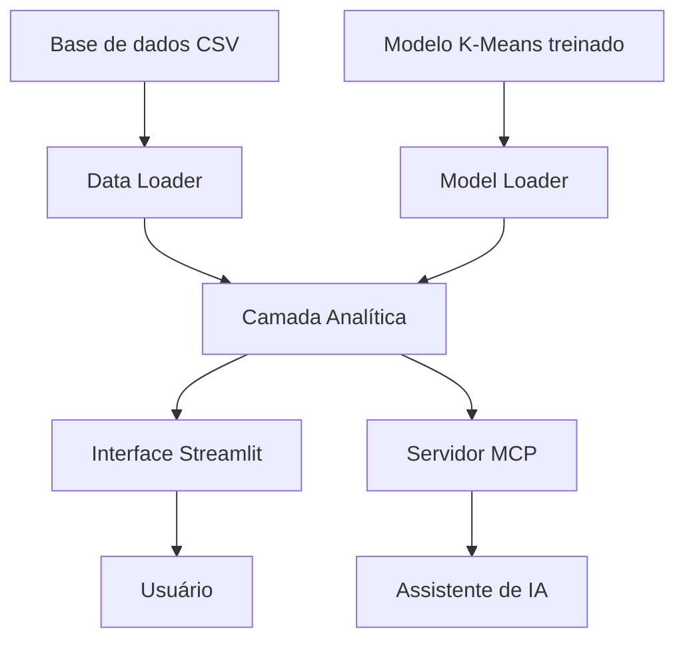

# Arquitetura do NBA Insight

## 1. Visão geral

O NBA Insight utiliza uma arquitetura modular desenvolvida em Python. O projeto separa o processamento dos dados, o carregamento do modelo de Machine Learning, as funções analíticas e as interfaces de acesso ao sistema.

A solução possui duas formas principais de interação:

- **Interface Streamlit:** permite que o usuário explore os dados e utilize as funcionalidades por meio de uma aplicação web interativa.
- **Servidor MCP:** disponibiliza as funcionalidades analíticas como ferramentas que podem ser utilizadas por assistentes de inteligência artificial compatíveis com o protocolo Model Context Protocol.

Ambas as interfaces utilizam a mesma camada de análise, evitando duplicação das regras de negócio.

## 2. Organização dos componentes

### 2.1. Camada de dados

Responsável pela leitura e preparação do conjunto de dados da NBA.

Arquivo principal: `data_loader.py`.

Responsabilidades:
- Carregar o arquivo CSV da temporada.
- Preparar os registros dos jogadores.
- Tratar registros agregados de atletas que passaram por múltiplas equipes.
- Disponibilizar os dados para as demais camadas.

### 2.2. Camada de configuração

Arquivo: `config.py`.

Centraliza configurações e caminhos utilizados pelo projeto, como:
- Diretório dos dados.
- Localização do modelo treinado.
- Temporada analisada.
- Quantidade de clusters.
- Atributos utilizados pelo modelo.

### 2.3. Camada do modelo

Arquivo: `model_loader.py`.

Responsável por carregar o artefato de Machine Learning armazenado em `artifacts/kmeans_nba_2026.joblib`.

O artefato contém os componentes necessários para aplicar o processamento e a classificação dos jogadores, incluindo o imputador, o padronizador e o modelo K-Means.

O treinamento é realizado separadamente pelo script `scripts/train_model.py`.

### 2.4. Camada analítica

Arquivo: `analytics.py`.

Concentra as principais operações de análise e processamento.

Entre suas responsabilidades estão:
- Pesquisa de jogadores.
- Comparação estatística entre atletas.
- Identificação de jogadores similares.
- Consulta e resumo dos clusters.
- Filtragem de jogadores por critérios estatísticos.
- Análise de perfis hipotéticos.
- Consulta das informações do modelo.

Essa camada é compartilhada pela interface Streamlit e pelo servidor MCP.

### 2.5. Interface de usuário

Arquivo: `app.py`.

Desenvolvida com Streamlit, oferece uma interface visual para acessar as funcionalidades do NBA Insight.

Apresenta:
- Dashboard geral.
- Consulta de jogadores.
- Busca por jogadores similares.
- Comparações.
- Exploração dos clusters.
- Criação e análise de perfis hipotéticos.

As visualizações são desenvolvidas utilizando Plotly.

### 2.6. Servidor MCP

Arquivo: `mcp_server.py`.

Implementa a comunicação por meio do Model Context Protocol utilizando FastMCP.

O servidor disponibiliza sete ferramentas para que assistentes de IA possam consultar e utilizar as funcionalidades analíticas do projeto.

As ferramentas são:
1. `buscar_jogador`
2. `comparar_jogadores`
3. `buscar_jogadores_similares`
4. `consultar_clusters`
5. `buscar_jogadores`
6. `analisar_perfil_hipotetico`
7. `consultar_modelo`

O servidor utiliza a camada analítica existente, sem implementar novamente as operações de processamento.

## 3. Fluxo de funcionamento

O funcionamento geral pode ser representado da seguinte forma:

A base de dados e o modelo treinado são carregados pelas respectivas camadas. A camada analítica utiliza esses recursos para executar as operações solicitadas.

As solicitações podem chegar pela interface Streamlit ou por ferramentas disponibilizadas pelo servidor MCP.

## 4. Modelo de Machine Learning

O projeto utiliza o algoritmo K-Means para agrupar jogadores com base em suas características estatísticas.

O processamento considera 16 atributos relacionados ao desempenho individual, incluindo pontuação, rebotes, assistências, arremessos e outras estatísticas por jogo.

Antes da classificação, os dados passam por:
- Imputação de valores ausentes utilizando a mediana.
- Padronização dos atributos com StandardScaler.

O modelo foi configurado com quatro clusters, `random_state=42` e `n_init=10`.

O artefato treinado é armazenado em `artifacts/kmeans_nba_2026.joblib` e reutilizado durante a execução da aplicação.

## 5. Identificação de jogadores similares

A funcionalidade de jogadores similares utiliza distância euclidiana no espaço das variáveis padronizadas.

Primeiramente, o jogador selecionado é representado por seu vetor de características. Em seguida, são calculadas as distâncias em relação aos demais jogadores.

Os atletas com menores distâncias são apresentados como os mais semelhantes estatisticamente.

Essa comparação considera as 16 variáveis utilizadas pelo modelo, não apenas a posição ou a pontuação dos jogadores.

## 6. Integração com inteligência artificial

A integração MCP permite que assistentes compatíveis acessem as operações do NBA Insight por meio de ferramentas estruturadas.

O servidor recebe os parâmetros das solicitações, executa as funções correspondentes na camada analítica e retorna os resultados.

Essa abordagem permite utilizar os recursos do projeto por meio de conversas em linguagem natural, sem exigir que o usuário acesse diretamente a interface Streamlit.

## 7. Testes

Os testes automatizados estão organizados no diretório `tests/`.

- `test_analytics.py`: testes das funcionalidades analíticas.
- `test_mcp_tools.py`: testes das ferramentas disponibilizadas pelo servidor MCP.

A execução dos testes é realizada utilizando Pytest.

## 8. Considerações finais

A arquitetura modular permite separar responsabilidades e reutilizar as funcionalidades analíticas em diferentes interfaces.

A utilização do MCP amplia as possibilidades de interação com o sistema, permitindo integrar os recursos de análise estatística a assistentes de inteligência artificial sem modificar o modelo de Machine Learning ou duplicar a lógica de processamento.